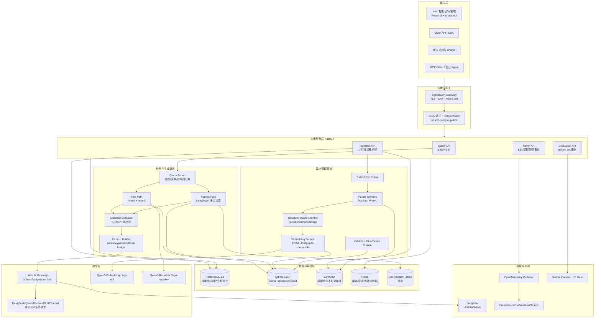
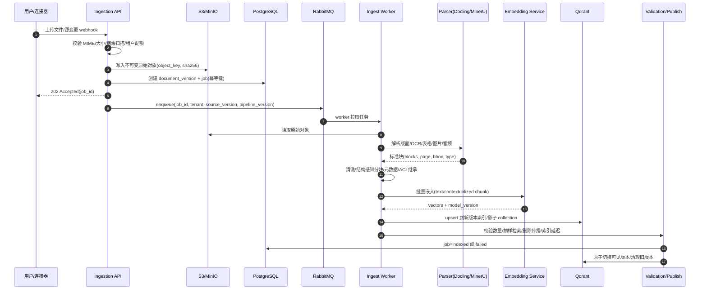
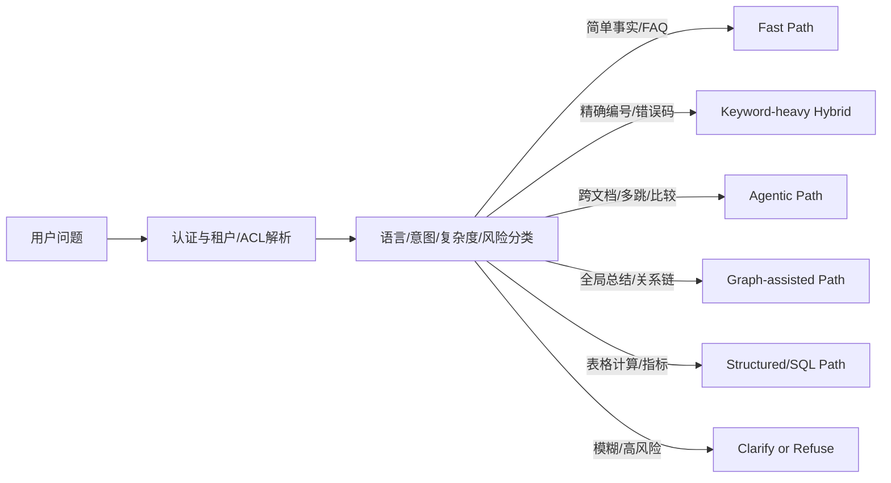
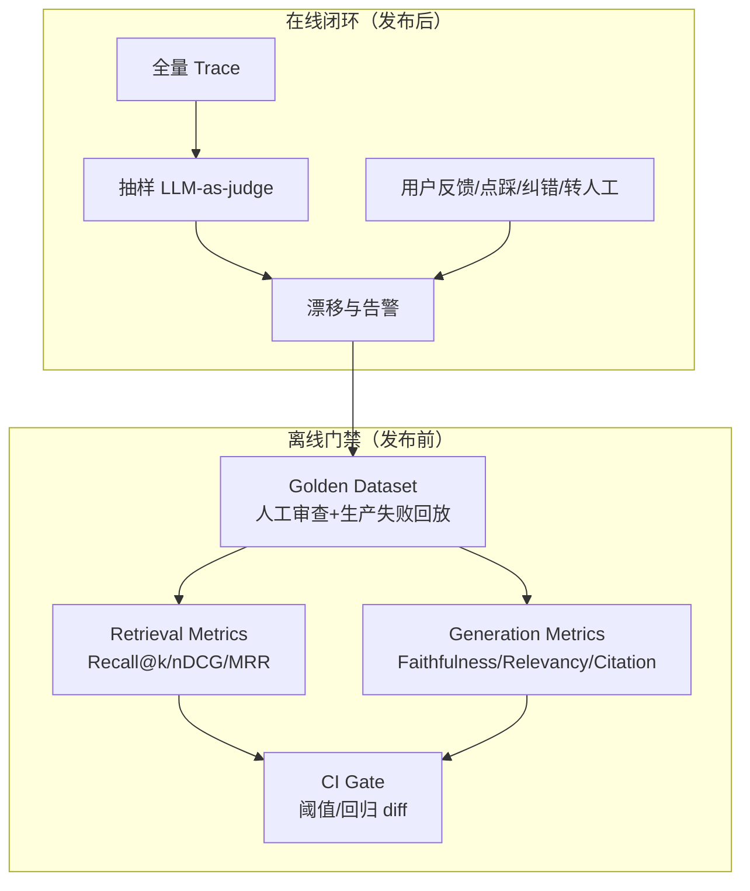

# 生产级多场景 RAG 知识库 2.0 架构蓝图

> 版本：v1.0（2026-11-28）  
> 定位：把当前单机演示型 RAG-KnowledgeBase 演进为**可真实上线、可扩展、可审计、可多场景复用**的企业级知识库平台。  
> 核心判断：**不存在一条能同时最优处理所有问题的固定 RAG 流水线**。生产级系统必须采用「高质量摄取 + 权限先行 + 查询路由 + 多路检索 + 证据校验 + 持续评估」的自适应架构。

---

## 0. 执行摘要

### 0.1 推荐的一句话架构

以 **FastAPI + PostgreSQL + Qdrant + S3/MinIO + RabbitMQ/Celery + LiteLLM Gateway + LangGraph + OpenTelemetry/Langfuse** 为主干，构建多租户、权限安全、异步摄取、混合检索、重排序、引用可追溯、可评估回归的企业级 RAG 平台；GraphRAG 与复杂 Agentic RAG 作为按需启用的慢路径，而不是默认路径。

### 0.2 默认技术栈（意见化选择）

| 层 | 默认选择 | 备选 / 降级 | 选择原因 |
|---|---|---|---|
| 后端 API | Python 3.12+ · FastAPI 0.165+ · Pydantic 2.x | Node/NestJS 仅在前端团队强时 | 生态成熟、异步能力强、AI/数据生态最广 |
| 前端 | React 19 · Vite 8 · TypeScript · Tailwind CSS · shadcn/ui | Next.js（需要 SEO/服务端渲染时） | 高颜值组件体系、开发效率高、企业后台适配好 |
| 控制面数据库 | PostgreSQL 18 + SQLAlchemy 2.x + Alembic | 云 RDS/Cloud SQL/Azure Database | 事务、审计、权限、任务状态、评价数据的单一事实源 |
| 检索引擎 | Qdrant 1.20+（dense + BM25/sparse + payload filter） | pgvector（轻量）、Milvus（超大规模）、OpenSearch（搜索主导） | 单一引擎支持混合检索、过滤、多租户、量化、水平扩展 |
| 原始文件存储 | S3 兼容对象存储；私有化用 MinIO | 云 OSS/COS/S3/Blob | 原始文件不可变保存、版本化、可回放 |
| 异步任务 | RabbitMQ + Celery 5.7 | 小规模 Redis + arq；云上用 SQS/PubSub | 摄取耗时长且易失败，必须可重试、可幂等、可观测 |
| 文档解析 | Docling 为主；MinerU 处理复杂中文 PDF/扫描件/公式表格 | Unstructured API / 云解析服务 | 覆盖 PDF/Office/HTML/图片/音频，保留版面、表格、页码与结构 |
| 嵌入模型 | Qwen3-Embedding-0.6B 默认；4B/8B 高质量 | bge-m3（dense/sparse/multi-vector 一体）、商用 embedding | Apache 2.0、多语言、长上下文、MTEB 表现强 |
| 重排序 | Qwen3-Reranker-0.6B 默认；4B 高精度 | bge-reranker-v2-m3、托管 rerank API | 两阶段检索的关键质量增益，按延迟预算选尺寸 |
| LLM 网关 | LiteLLM Proxy | One API/new-api、云 API Gateway | 统一 OpenAI 兼容协议、故障转移、预算、限流、成本日志 |
| Agent 编排 | LangGraph + PostgreSQL checkpointer | 自研状态机（简单场景） | 持久化、恢复、人工介入、复杂检索循环更可靠 |
| 工具协议 | MCP（受控启用） | 内部 function calling | 生态广泛，但必须做权限代理、工具白名单和输出消毒 |
| 可观测性 | OpenTelemetry + Prometheus/Grafana/Tempo/Loki + Langfuse | 云厂商 APM | 同时覆盖系统指标、分布式链路、LLM 语义轨迹与成本 |
| 评估 | RAGAS / DeepEval + 自建检索指标 + 业务黄金集 | Langfuse evaluation、人工评审台 | 离线门禁 + 在线抽样 + 用户反馈闭环 |
| 身份与权限 | OIDC/SAML（Keycloak 或企业 IdP）+ RBAC/ABAC | 云 IAM、Casbin 辅助策略 | 企业落地的先决条件；权限必须先于检索执行 |

> “最新”不等于“刚发布就上生产”。本蓝图采用的原则是：**选择当前仍活跃、广泛采用、文档完善、可自托管或可云托管的技术；对刚发布的大版本保留灰度升级窗口**。

---

## 1. 目标与非目标

### 1.1 必须支持的生产场景

1. 企业制度、产品文档、FAQ 的内部问答。
2. 客服知识库与客户自助问答，要求低延迟、高命中、可转人工。
3. 法律、合规、财务、合同等高审计场景，要求引用、页码、版本、权限与不可抵赖日志。
4. 技术文档、运维手册、错误码、API 文档等精确术语场景。
5. 论文、研报、跨文档综合分析等多跳推理场景。
6. 表格、扫描件、图片、PPT、音频转写等多模态/复杂版式场景。
7. 中英混合、跨语言检索与多语言回答。
8. 多租户 SaaS 或集团多部门部署，要求租户隔离、配额与数据驻留。
9. 需要调用业务系统/搜索/工单/数据库工具的受控 Agentic RAG。

### 1.2 非目标

- 不追求“所有问题都自动调用 Agent”。简单事实问题走快路径，复杂问题才进入多步循环。
- 不把 GraphRAG 当作默认检索。图谱是补充索引，适合跨实体、多跳、全局总结类问题。
- 不用 LLM 直接替代权限系统、审计系统或数据治理系统。
- 不承诺仅凭 prompt 就能消除幻觉；必须靠检索质量、证据校验、引用约束、评估门禁共同控制。

---

## 2. 多场景能力矩阵

| 场景 | 主要风险 | 推荐路径 | 必须能力 |
|---|---|---|---|
| 内部制度/HR/IT FAQ | 相似制度混淆、版本过期 | 快路径 hybrid + rerank | 文档版本、引用、反馈入口 |
| 客服/售前 | 延迟敏感、错误成本高 | 缓存 + hybrid + rerank + 置信度分层 | 低置信拒答/转人工、会话记忆、热更新 |
| 法律/合同/合规 | 条款漏检、错引、越权 | 高精度解析 + parent-child + 引用页码 + 审计 | ACL、不可变版本、条款级引用、审计日志 |
| 技术文档/错误码 | 精确字符串被语义检索淹没 | BM25/keyword + dense hybrid | 精确匹配、代码/表格保留、元数据过滤 |
| 研报/论文/多文档综合 | 跨文档关系缺失 | Agentic + GraphRAG 按需 | 多跳规划、图谱、社区摘要、预算控制 |
| 扫描件/复杂 PDF | OCR/版面/表格错误 | MinerU/Docling 分层解析 | OCR、表格结构、页码/bbox、解析置信度 |
| Excel/财报/表格 | 数字被拆块失真 | 表格块 + SQL/结构化索引 + 文本混合 | 表格原子化、列语义、计算工具 |
| 医疗/金融强监管 | 数据出域、撤销滞后 | 私有模型 + 严格 ACL + 实时复核 | 数据驻留、加密、审计、fail-closed |
| 多语言知识库 | 跨语言漏召回 | Qwen3/bge-m3 多语嵌入 | cross-lingual retrieval、语言检测 |
| 业务系统联动 | 工具越权、数据外泄 | LangGraph + MCP 权限代理 | 用户委派授权、最小权限、审批、防注入 |

---

## 3. 总体架构



### 3.1 三个平面分离

| 平面 | 内容 | 可用性要求 | 说明 |
|---|---|---|---|
| 控制面 | 租户、用户、知识库、权限、连接器、任务、审计、评估 | 强一致 | PostgreSQL 是事实源，所有变更写审计事件 |
| 数据面 | 原始文件、解析结果、分块、向量、稀疏索引、图索引 | 最终一致，可重建 | 对象存储保原始事实，索引可从原始数据回放重建 |
| 查询面 | 查询路由、混合检索、重排、生成、流式输出 | 低延迟、高可用 | 无状态水平扩展；状态放 PostgreSQL/Redis/Qdrant |

---

## 4. 开源生态调研结论（优缺点与避坑）

| 项目 | 更适合什么 | 主要优点 | 主要风险/不足 | 对本设计的借鉴 |
|---|---|---|---|---|
| RAGFlow | 开箱即用文档 RAG 平台 | DeepDoc 文档理解、模板化 chunk、混合检索、完整 UI | 资源要求高；平台数据模型较 opinionated；深度定制权限/审计成本高 | 文档解析优先、按文档类型选择 chunk 模板 |
| Dify | LLM 应用/工作流平台 | 可视化 workflow、应用编排、模型插件生态、知识管道 | 知识库只是应用节点；深度检索控制不如专用 RAG；许可证有附加条件 | 可视化 pipeline、应用层与检索层解耦 |
| Haystack | Python 检索流水线框架 | 组件化、pipeline 清晰、文档成熟 | 产品化 UI/权限/审计/多租户需自建 | 检索组件接口化、可替换 DocumentStore |
| LlamaIndex | 数据连接和索引抽象 | 连接器/reader 生态广、索引策略多 | 抽象层多、版本演进快；生产运维仍需自建 | connector 生态、small-to-big/索引模式 |
| R2R | API-first 检索后端 | pgvector + S3、collection 权限、REST/SDK 清晰 | Agent/端到端观测能力仍需验证；生态较小 | API-first、collection 级权限模型 |
| Microsoft GraphRAG | 全局/多跳/实体关系问题 | 社区检测、实体关系摘要、复杂推理明显增强 | 索引 LLM 成本高；官方也提示需先小数据集验证 | 图谱只做增量补充，不进默认快路径 |
| LightRAG | 轻量图增强检索 | local/global/hybrid/mix 模式，工程上更轻 | 默认内存存储不适合生产；多存储无跨库事务；写扩展受限 | 图索引与向量索引组合，而非替代 |
| 当前 RAG-KnowledgeBase | 单机演示/作品集 | 离线 Mock、混合检索、CRAG、图谱、评估均有雏形 | 无认证/多租户；同步摄取；numpy 全扫；BM25 重启丢失；无对象存储/任务/审计/观测 | 保留清晰分层、可插拔抽象、离线测试能力 |

结论：**不要直接套一个平台**。正确方式是吸收各平台成熟模式，但把权限、审计、数据模型、检索策略和评估体系掌握在自己代码里；否则一旦进入企业真实场景，二次开发会被平台边界卡死。

---

## 5. 数据摄取与索引设计

### 5.1 生产摄取流水线



### 5.2 关键原则

1. **异步化**：上传接口只负责接收与登记，返回 `202 + job_id`；解析、OCR、嵌入、索引全部后台执行。
2. **幂等**：`tenant_id + source_id + source_version + pipeline_version + operation` 组成幂等键；worker 重试不能产生重复 chunk。
3. **不可变原始对象**：原始文件进对象存储并记录 SHA-256；所有派生物可重建。
4. **pipeline_version**：解析器、chunker、embedding、metadata schema、ACL 规则任一变化，都要触发可追踪的重处理或 blue/green reindex。
5. **原子发布**：先写入影子索引并验证，再切换可见版本；失败时保留旧索引继续服务。
6. **删除与撤销传播**：文档删除、权限撤销、源断开都必须形成 tombstone，并在向量、稀疏、图、缓存中传播。

### 5.3 文档解析策略

| 文档类型 | 默认解析 | 备选 | 必须保留的元数据 |
|---|---|---|---|
| Markdown/TXT/HTML | 原生解析 | readability/HTML cleaner | 标题层级、anchor、source_url |
| PDF（文本型） | Docling | pypdf 快速路径 | 页码、标题、段落、bbox、表格 |
| PDF（扫描/复杂版式/中文） | MinerU | Docling OCR/VLM、云 OCR | OCR 置信度、页码、bbox、图片区域 |
| DOCX/PPTX/XLSX | Docling | LibreOffice 转换 + 专用解析 | 样式层级、表格、sheet、幻灯片页码 |
| 图片 | OCR/VLM caption | 多模态 embedding | 图像 hash、ocr_text、caption、bbox |
| 音频/视频字幕 | ASR/Whisper 或云转写 | WebVTT 原生解析 | 时间戳、说话人、片段 |
| 代码/API 文档 | 语法感知 chunker | tree-sitter | repo/path/symbol/language/version |

**避坑**：不要只用 `pypdf` 提取纯文本。生产 PDF 常见问题包括扫描件、双栏、页眉页脚、跨页表格、公式、图片文字；这些正是企业知识库的核心语料。

### 5.4 分块策略

没有通用最佳 chunk size。采用**结构感知 + token 感知 + parent-child**：

- child chunk：用于嵌入和精确召回，通常 300–800 tokens（中文按 token 而不是字符）。
- parent chunk：用于生成上下文，通常 1,000–3,000 tokens 或一个完整小节。
- overlap：一般为 chunk size 的 10%–20%，但不能跨标题/表格/代码块硬切。
- table：优先作为结构化块保留表头与行组，跨页表要合并或显式链接。
- image：索引 OCR 文本 + caption + 所在页上下文，不只索引 caption。
- metadata：必须包含 `tenant_id/kb_id/document_id/version/chunk_id/parent_id/page/heading_path/content_type/acl/pipeline_version`。

---

## 6. 检索与生成架构

### 6.1 查询路由器



路由器不一定是 LLM。优先顺序：规则/元数据 → 小模型分类 → LLM fallback。所有路由决策写入 trace，便于评估误路由率。

### 6.2 Fast Path（默认 80% 流量）

1. 查询改写：仅在多轮指代明显时执行，避免每轮多花一次 LLM 成本。
2. ACL pre-filter：从认证主体派生 `tenant_id + kb_ids + principal/group/security_label` 过滤条件，**在检索前执行**。
3. 双路召回：
   - dense：Qwen3-Embedding 向量召回；
   - sparse/BM25：Qdrant full-text/BM25 或 sparse vector，中文使用 multilingual tokenizer。
4. RRF 或 weighted fusion 融合，候选数建议 50–100。
5. Qwen3-Reranker 精排 top 10–20。
6. dedupe/MMR 去除相邻重复 chunk，保证来源多样性。
7. child → parent 扩展，按 token budget 组包上下文。
8. 证据充分性检查：不足时改写查询重试一次；仍不足则明确拒答或转人工。
9. 生成：只允许使用证据块，要求逐条引用 `[S1]`，并说明冲突/版本。
10. 引用校验：答案中的引用 ID 必须存在于返回证据；高风险场景可做 claim-level entailment 抽检。

### 6.3 Agentic Path（只给复杂问题）

适合多跳、比较、跨源、需要工具的问题。使用 LangGraph 实现显式状态机：

- 状态：原始问题、子问题、已检索证据、缺失信息、工具调用、预算、停止原因。
- 限制：`max_steps`、wall-clock timeout、token/cost budget、每类工具调用次数。
- 工具：knowledge_search、keyword_search、graph_query、sql_query、web_search、ticket_search、calculator。
- 安全：所有工具经权限代理；读写分离；高风险写操作必须人工审批。
- 输出：最终答案 + 证据链 + 检索轨迹 ID + 停止原因。

### 6.4 Graph-assisted Path（可选）

图谱不是默认索引，而是以下问题的补充：

- “A 和 B 有什么关系？”
- “某政策变化影响哪些系统/部门？”
- “跨多份文档总结某主题脉络。”

推荐策略：

1. 初期用 PostgreSQL graph tables 存实体、关系、出处，避免过早引入 Neo4j 运维成本。
2. 关系抽取异步执行，实体/关系必须回链到 chunk/document/page。
3. 只在查询路由判定为关系型/全局型时启用 graph expansion。
4. 高成本 community summary 按租户/知识库显式开启，不默认构建。
5. 图谱结果必须与普通 chunk 一起进入证据评估，不能因为是图关系就免于引用。

### 6.5 表格与结构化数据

表格不能只切块嵌入。生产做法是三类索引并存：

- 文本索引：表标题、表说明、行列语义摘要。
- 结构化索引：CSV/Parquet/关系表，支持 SQL 或 DuckDB 查询。
- 引用索引：每个单元格/行组映射回原文件页码或 sheet/range。

当问题是“计算/汇总/对比指标”时，优先走 SQL/计算工具，再让 LLM 解释结果；不要让 LLM 从切碎的表格文本里心算。

---

## 7. 多租户、权限与安全设计

### 7.1 权限模型

- 认证：OIDC/SAML 对接 Keycloak、Entra ID、Auth0、企业微信/钉钉等 IdP。
- 授权：租户隔离 + 知识库角色 + 文档级 ACL + 安全标签。
- 角色：`owner/admin/editor/viewer/auditor/api_client`。
- 文档权限元数据：允许主体、允许组、拒绝主体、密级、数据驻留、有效期、permission_version。
- 高风险文档：索引内 ACL 只做候选过滤，返回前再进行源系统实时复核；权限证据过期则 fail closed。

### 7.2 Qdrant 多租户策略

默认采用**共享 collection + tenant payload field + tenant index**；仅为极少数大型/强隔离租户创建 dedicated collection 或 shard。原因：每租户一个 collection 会产生大量 shard 与运维开销。Qdrant 官方也建议按 payload partition，而不是为用户数爆炸式创建 collection。

### 7.3 RAG 特有安全控制

| 风险 | 控制 |
|---|---|
| 文档投毒/间接 prompt injection | 上传审核、hash/manifest、隐藏 Unicode 检测、检索文本标记为 data、工具调用二次确认 |
| 跨租户泄漏 | 服务端派生 tenant filter、禁止客户端传任意 tenant、权限回归测试、审计查询 |
| 记忆投毒 | 记忆写入白名单/用户确认；记忆内容进入上下文前标记低信任；TTL 与删除 API |
| 工具越权 | MCP 工具白名单、最小权限 token、用户委派授权、读写分离、审批 |
| 文件攻击 | MIME sniffing、大小/页数/解压限制、病毒扫描、隔离区、禁用宏/脚本 |
| 密钥泄漏 | Vault/KMS/云 Secret Manager；应用只拿短期凭据；禁止密钥写入日志/trace |
| 引用造假 | 引用 ID 服务端绑定证据；响应后校验引用存在性和 hash；保存不可变 retrieval snapshot |
| 数据删除不彻底 | tombstone 事件驱动删除向量/图/缓存/派生物；定期对账 |

参考 OWASP RAG Security Cheat Sheet：RAG 并不天然降低风险，而是把风险扩散到摄取、索引、检索、生成和工具调用全链路。

---

## 8. 模型层设计

### 8.1 LLM Gateway

所有 LLM 调用必须经过 LiteLLM Proxy 或等价网关：

- 统一 OpenAI-compatible API。
- provider failover：主模型超时/限流/5xx 时按策略 fallback。
- virtual key、team/user budget、RPM/TPM 限流。
- cost/token/spend log。
- trace 与 Langfuse/OpenTelemetry 联动。
- 模型别名：应用只写 `rag-fast`、`rag-high-quality`、`eval-judge`，不硬编码具体厂商。

### 8.2 嵌入与重排序

| 用途 | 默认 | 何时升级/替换 |
|---|---|---|
| 通用多语嵌入 | Qwen3-Embedding-0.6B | 对质量敏感且有 GPU 时升 4B/8B；对成本敏感时保持 0.6B 或降维 |
| 中文/跨语言/长文本 | Qwen3 系列或 bge-m3 | bge-m3 在需要单模型同时产出 dense/sparse/multi-vector 时很有价值 |
| 重排序 | Qwen3-Reranker-0.6B | 高精度法律/医疗用 4B；高 QPS 用更小模型或降低候选数 |
| 私有部署 | TEI/vLLM OpenAI-compatible serving | 数据敏感或出域受限时必须私有化 |
| 商用 API | 阿里/硅基流动/OpenAI 等 | 快速上线、低运维，但要评估数据合规和成本 |

**强制规则**：embedding/reranker 模型名、版本、维度进入索引元数据。切换模型必须 blue/green reindex，不能在同一 collection 混用不同维度/语义空间。

---

## 9. 质量评估与持续改进

### 9.1 双层评估体系



### 9.2 指标体系

| 层 | 指标 |
|---|---|
| 检索 | Recall@5/10、nDCG@10、MRR、无命中率、误召回率、过滤后候选数 |
| 生成 | faithfulness、answer relevance、refusal correctness、冲突处理正确率 |
| 引用 | citation precision/recall、无引用率、错引率、页码准确率 |
| 安全 | 越权检索测试通过率、prompt injection 拦截率、敏感信息泄漏率 |
| 系统 | TTFT/总延迟、检索耗时、rerank耗时、token成本、错误率、fallback率 |
| 业务 | 首次解决率、转人工率、点踩率、采纳率、覆盖文档点击率 |

### 9.3 发布门禁建议

不要一开始追求绝对满分；先建立 baseline，再把以下规则纳入 CI/CD：

- 任何 embedding/chunking/parser/prompt/reranker 变更必须跑 golden set。
- 核心指标相对上一版本下降超过 2 个百分点则阻断发布。
- 安全/越权/删除传播测试必须 100% 通过。
- 新增生产 badcase 必须回填 golden set，才能关闭事故单。

---

## 10. 可观测性与审计

### 10.1 观测分层

- 系统层：FastAPI/Qdrant/PostgreSQL/RabbitMQ/Redis/MinIO 的 RED/USE 指标。
- 链路层：OpenTelemetry trace，一次问答覆盖 `auth → route → embed → retrieval → rerank → prompt → llm → citation_check`。
- LLM 语义层：Langfuse 记录 prompt、模型、token、成本、检索快照、评分、用户反馈。
- 审计层：谁在何时以何权限访问/修改/删除哪份文档、哪个版本被用于回答。

### 10.2 Trace 必须包含的字段

`trace_id, tenant_id, user_subject_hash, kb_id, query_type, route, retrieval_ms, rerank_ms, llm_ms, ttft_ms, embedding_model, reranker_model, llm_model_alias, candidate_count, evidence_chunk_ids, citation_ids, cost_usd, feedback_id, stop_reason`。

> 注意：trace 中默认不记录明文敏感全文；必要时做脱敏、采样或加密存储，并设置数据保留期。

---

## 11. 数据模型与 API 草案

### 11.1 PostgreSQL 核心表

| 表 | 关键字段 |
|---|---|
| tenants | id, name, status, region, created_at |
| users / groups / memberships | id, tenant_id, external_subject, role, timestamps |
| knowledge_bases | id, tenant_id, name, visibility, embedding_model, retrieval_policy |
| sources | id, kb_id, type, config_ref, sync_state, cursor, auth_ref |
| documents | id, tenant_id, kb_id, source_id, title, mime, current_version, acl_version, status |
| document_versions | id, document_id, version, sha256, object_key, parser_version, pipeline_version, status |
| chunks | id, document_version_id, parent_id, idx, content_type, text_hash, heading_path, page_range, metadata_json |
| ingestion_jobs | id, tenant_id, idempotency_key, type, status, attempt, error, payload_json |
| conversations / messages | id, tenant_id, user_id, title, role, content_ref, trace_id |
| query_traces | id, tenant_id, user_id, route, latency, cost, evidence_snapshot_ref |
| feedback | id, trace_id, rating, correction, comment, created_at |
| eval_datasets / eval_cases / eval_runs | id, kb_id, input, expected, tags, metrics_json, status |
| audit_events | id, tenant_id, actor, action, resource, before/after hash, created_at |

### 11.2 Qdrant payload 草案

```json
{
  "tenant_id": "t_123",
  "kb_id": "kb_001",
  "document_id": "doc_001",
  "document_version": 7,
  "chunk_id": "chk_abc",
  "parent_id": "sec_12",
  "content_type": "paragraph|table|image|code",
  "heading_path": ["第三章", "3.2 权限"],
  "page_start": 12,
  "page_end": 13,
  "acl": {"groups": ["g_legal"], "labels": ["internal"]},
  "embedding_model": "Qwen/Qwen3-Embedding-0.6B",
  "pipeline_version": "ingest-v2026.11",
  "source_hash": "sha256:...",
  "deleted": false
}
```

### 11.3 API 草案

| API | 说明 |
|---|---|
| `POST /v1/knowledge-bases` | 创建知识库与检索策略 |
| `POST /v1/documents` | 上传文件，返回 `202 + job_id` |
| `POST /v1/sources` | 创建连接器（S3/Confluence/SharePoint/Web/数据库） |
| `GET /v1/jobs/{job_id}` | 查询摄取状态、阶段、错误、重试次数 |
| `POST /v1/query` | 非流式问答，返回答案、引用、trace_id |
| `POST /v1/query/stream` | SSE 流式问答 |
| `POST /v1/feedback` | 用户反馈与纠错 |
| `POST /v1/evals/runs` | 触发离线评估 |
| `GET /v1/admin/audit-events` | 审计查询 |
| `POST /mcp` | 受控 MCP 工具端点（search/read/cite） |

---

## 12. 部署拓扑

### 12.1 轻量生产档（单企业/单部门）

- 1–2 台 VM 或小型 Kubernetes namespace。
- FastAPI ×2、worker ×2、PostgreSQL 单主+备份、Qdrant 单节点或 2 副本、MinIO 单节点、RabbitMQ 单节点、Redis 单节点。
- 适合：几十万到百万级 chunk、低到中等 QPS。
- 重点：备份、监控、TLS、权限、评估门禁，而不是过度分布式。

### 12.2 标准生产档（推荐）

- Kubernetes 托管 API/worker，HPA 按 CPU + queue depth + tokens/sec 扩容。
- PostgreSQL/Qdrant/对象存储优先使用云托管或至少三节点高可用。
- RabbitMQ quorum queue；Redis 仅缓存不做唯一事实源。
- LiteLLM、Langfuse、OTel Collector 独立部署。
- 蓝绿/金丝雀发布，schema migration 向后兼容。

### 12.3 大规模/强隔离档

- Qdrant cluster 或 Milvus cluster；索引按业务域拆分，不按小租户拆分。
- 高价值租户可 dedicated collection/shard，满足容量或合规隔离。
- 多区域时按数据驻留拆分控制面与索引，不做跨区透明混查。
- 图数据库、GPU embedding/reranker 独立资源池，避免影响查询快路径。

---

## 13. SLO 与成本控制

### 13.1 初始 SLO（必须实测校准）

| 指标 | 建议初始目标 |
|---|---|
| 查询服务可用性 | 99.9% |
| Fast Path 检索+重排 | p95 < 800ms（不含外部 LLM 网络） |
| Fast Path TTFT | p95 < 3s（模型正常时） |
| Agentic Path | p95 < 20s，且必须有进度事件 |
| 摄取可见性 | 普通文本小文档 p95 < 2min；OCR/大 PDF 单独分级 |
| 权限撤销传播 | 普通文档 < 5min；高敏文档实时复核 |
| 数据恢复 | PostgreSQL PITR；对象存储版本化；索引可从原始数据重建 |

### 13.2 成本控制手段

1. 查询路由：简单问题不进入 Agentic；agentic 设置步数、时间和 token budget。
2. 缓存：embedding、检索结果、改写结果、热门问答；缓存 key 必须包含租户/权限/版本。
3. 批处理：嵌入批量请求，worker 动态批量化。
4. 重排候选自适应：高置信快速返回，低置信才扩大候选。
5. Qdrant quantization：上线前用 golden set 测量 recall 损失，不盲目开启。
6. 模型分层：fast/default/high-quality 三档模型别名，按场景和预算选择。
7. 租户配额：按 tokens、文档页数、OCR 页数、embedding 数、存储量计费或限量。

---

## 14. 从当前仓库演进的实施路线图

### Phase 0：安全与工程底线（1 周）

- 增加认证、API 权限、上传大小/类型/病毒扫描、rate limit。
- 修复 BM25 重启后丢失问题；统一索引重建逻辑。
- 增加结构化日志、request id、基础 metrics。
- 补齐真实集成测试、端到端测试、docker-compose 健康检查。

### Phase 1：生产数据底座（2–3 周）

- PostgreSQL 控制面 + Alembic migration。
- S3/MinIO 原始文件存储；document/version/job 数据模型。
- RabbitMQ/Celery 异步摄取；幂等与重试；状态查询 API。
- Qdrant 替代 numpy 向量库；payload 过滤；blue/green collection alias。
- chunk 元数据、parent-child、引用 ID、证据快照。

### Phase 2：检索质量（2–4 周）

- Docling/MinerU 分层解析；复杂 PDF/OCR/表格支持。
- Qdrant dense+BM25 hybrid；中文 tokenizer 验证；RRF/weighted fusion。
- Qwen3 embedding/reranker 接入；模型版本化与 reindex。
- 查询改写、CRAG、parent expansion、citation validation。
- golden dataset、RAGAS/DeepEval、CI gate。

### Phase 3：企业能力（3–6 周）

- OIDC/RBAC/文档 ACL；权限撤销传播；审计日志。
- LiteLLM gateway；多模型 fallback、预算、限流、成本报表。
- OpenTelemetry + Langfuse + Grafana 仪表板。
- 连接器框架与第一批连接器（本地目录、S3、Web、Confluence/SharePoint 按需）。
- 多租户配额、管理台、反馈闭环。

### Phase 4：高级场景（按需，4 周以上）

- LangGraph agentic path、MCP 工具代理、审批流。
- Graph-assisted retrieval；增量图谱与出处链。
- 表格结构化查询、SQL/DuckDB 工具。
- 多模态音频/图片/视频检索。
- 大规模 HA/DR、性能压测、故障演练、私有化部署包。

---

## 15. 关键风险与规避

| 风险 | 为什么常见 | 规避 |
|---|---|---|
| 过度追求“全自动 Agent” | 延迟和成本放大，质量未必提升 | 路由器分流；简单问题固定管线；复杂问题预算化 |
| 以为向量数据库能解决权限 | 权限是业务与合规问题 | 权限先入 metadata，服务端强制 pre-filter，高敏实时复核 |
| 低估解析难度 | 企业文档扫描件/表格/双栏多 | 解析质量专项评测；分层 parser；保留页码/bbox |
| 混合检索中文效果差 | tokenizer 不匹配 | 用 multilingual tokenizer 或外部分词；用中文 golden set 验证 |
| 嵌入模型替换导致全库失真 | 向量空间不可混用 | 模型版本元数据 + blue/green reindex |
| 队列重试产生重复索引 | worker/网络失败会重试 | 幂等键、内容 hash、版本化 upsert、原子发布 |
| GraphRAG 成本失控 | 实体/关系/社区摘要大量 LLM 调用 | 按需启用、增量构建、FastGraphRAG/廉价模型先验证 |
| 引用看似专业但不支持结论 | 模型可能 post-rationalize | evidence snapshot、引用 ID 校验、claim-level 抽检 |
| trace 泄漏敏感信息 | prompt/文档全文进入日志 | 默认脱敏、采样、加密、保留期、访问审计 |
| 过早微服务化 | 小团队运维爆炸 | 模块化 monolith + worker 起步，明确 service boundary，按需拆分 |

---

## 16. 架构决策记录（ADR 摘要）

### ADR-001：检索引擎默认选择 Qdrant

选择 Qdrant 而不是继续 numpy/pgvector/Milvus/OpenSearch 作为默认检索引擎：

- 相比 numpy：有 ANN、过滤、持久化、集群、量化、生产运维能力。
- 相比 pgvector：混合检索与向量专用运维能力更强；pgvector 仍适合轻量版。
- 相比 Milvus：单机到中小规模更轻；Milvus 保留为超大规模替代。
- 相比 OpenSearch：向量/过滤/多租户更聚焦；OpenSearch 保留为关键词搜索主导场景替代。

### ADR-002：保留模块化单体，不拆成大量微服务

初期拆成 API、worker、embedding service、gateway 已经足以满足扩展；权限/审计/检索编排在模块化 monolith 内维护，待组织与流量增长后再拆。微服务数量不是生产级指标，可靠性与一致性才是。

### ADR-003：Agentic 与 Graph 只做按需慢路径

默认流量走可预测、可缓存、低成本的 fast path；只有路由器判断需要多步/跨源/关系推理时才进入 LangGraph 或 Graph-assisted path，并携带预算与审计。

### ADR-004：文档原始字节与派生索引分离

原始文件不可变存储于对象存储；chunk/vector/graph 都是可重建派生物。这样模型、parser、chunker 升级时可回放重建，删除与权限变更也有明确事实源。

---

## 17. 参考资料

- Qdrant production checklist：<https://qdrant.tech/documentation/production-checklist/>
- Qdrant multitenancy：<https://qdrant.tech/documentation/deploy-and-scale/multitenant-search/>
- Qdrant hybrid search：<https://qdrant.tech/documentation/search-tuning/hybrid-search/>
- Qdrant BM25 / multilingual tokenizer：<https://qdrant.tech/documentation/inference/inference-bm25/>
- pgvector：<https://github.com/pgvector/pgvector>
- Milvus hybrid search：<https://milvus.io/solutions/hybrid-search>
- Docling：<https://github.com/docling-project/docling> 与 chunking 文档 <https://docling-project.github.io/docling/concepts/chunking/>
- MinerU：<https://github.com/opendatalab/MinerU>
- Qwen3 Embedding/Reranker：<https://qwenlm.github.io/blog/qwen3-embedding/> 与 <https://github.com/QwenLM/Qwen3-Embedding>
- bge-m3：<https://bge-model.com/bge/bge_m3>
- LangGraph persistence：<https://docs.langchain.com/oss/python/langgraph/persistence> 与 Agentic RAG <https://docs.langchain.com/oss/python/langgraph/agentic-rag>
- LiteLLM production/reliability：<https://docs.litellm.ai/docs/proxy/prod> / <https://docs.litellm.ai/docs/proxy/reliability>
- Microsoft GraphRAG：<https://microsoft.github.io/graphrag/>（官方明确提示索引可能消耗大量 LLM 资源）
- LightRAG storage production notes：<https://github.com/HKUDS/LightRAG>
- OWASP RAG Security Cheat Sheet：<https://cheatsheetseries.owasp.org/cheatsheets/RAG_Security_Cheat_Sheet.html>
- OWASP Prompt Injection：<https://genai.owasp.org/llmrisk/llm01-prompt-injection/>
- Azure secure multitenant RAG：<https://learn.microsoft.com/en-us/azure/architecture/ai-ml/guide/secure-multitenant-rag>
- Azure RAG prompt grounding：<https://learn.microsoft.com/en-us/azure/architecture/ai-ml/guide/rag/rag-prompt-engineering>
- RAGAS faithfulness：<https://docs.ragas.io/en/stable/concepts/metrics/available_metrics/faithfulness/>
- FastAPI OpenTelemetry：<https://fastapi.tiangolo.com/advanced/opentelemetry/>
- Langfuse self-hosting/tracing：<https://langfuse.com/self-hosting> / <https://langfuse.com/docs/observability/get-started>
- Celery brokers：<https://docs.celeryq.dev/en/stable/getting-started/backends-and-brokers/>
